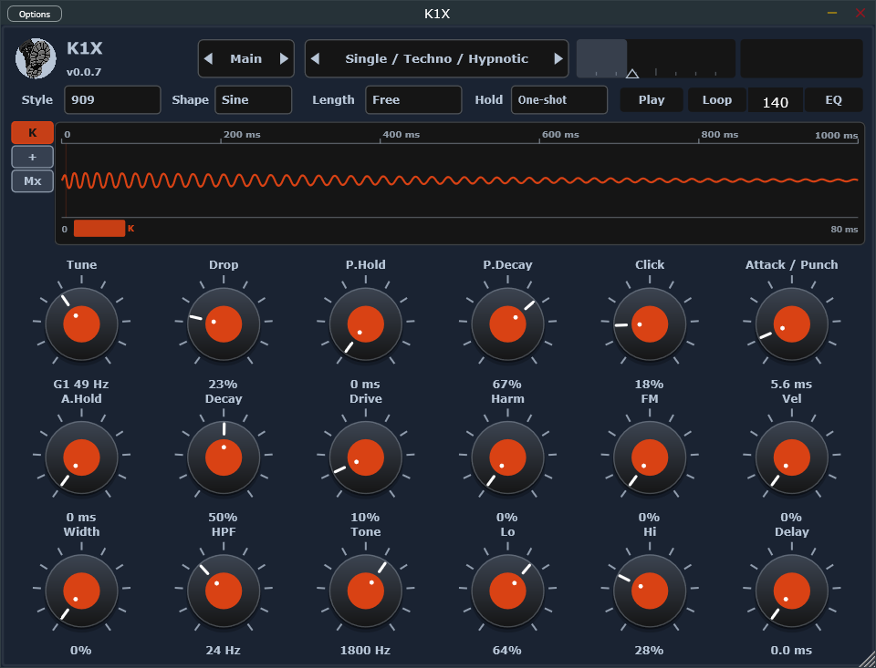
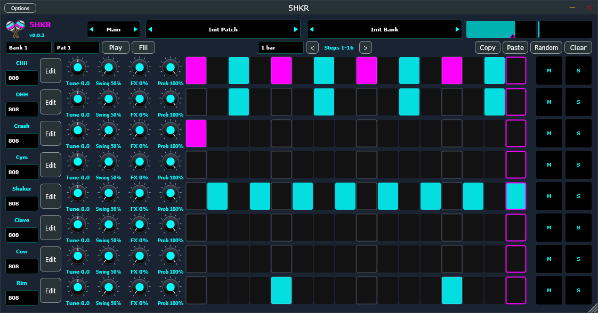
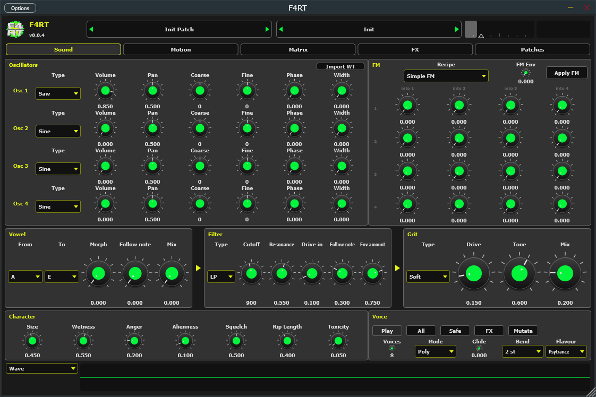

  

<h1 align="center">Stupid Audio</h1>

  Free, open-source VST3 and standalone instruments from Stupid Audio. 
  <a href="https://iamtew.github.io/audio-plugins/">iamtew.github.io/audio-plugins</a>

You already have the ideas. These five free, open-source instruments are here so those ideas stop dying in the demo folder.
Acid that bites, a kick that means it, perc that actually grooves, pads for the fog, and a psytrance fart designer that is not joking — except when it is.
VST3 and standalone. No dongle, no sermon, no “pro” tax.

Steal them. Twist them. This generation’s must-haves!

<table>
  <tr>
    <td align="center" width="20%">
       
      <strong>TEW03</strong> 
      Monophonic acid synth. Classic 303 squelch plus extra nastiness. 
      <a href="https://iamtew.github.io/TEW03/">Site</a> ·
      <a href="https://github.com/iamtew/TEW03">Repo</a>
    </td>
    <td align="center" width="20%">
       
      <strong>K1X</strong> 
      Kick drum (909 / 808 / 707 / Tight / Hard). One job. It thumps. 
      <a href="https://iamtew.github.io/K1X/">Site</a> ·
      <a href="https://github.com/iamtew/K1X">Repo</a>
    </td>
    <td align="center" width="20%">
       
      <strong>5HKR</strong> 
      Shaker. Perc groove box. 
      <a href="https://iamtew.github.io/5HKR/">Site</a> ·
      <a href="https://github.com/iamtew/5HKR">Repo</a>
    </td>
    <td align="center" width="20%">
       
      <strong>V4JB</strong> 
      Atmosphere and texture. Pads, drones, air, fog. 
      <a href="https://iamtew.github.io/V4JB/">Site</a> ·
      <a href="https://github.com/iamtew/V4JB">Repo</a>
    </td>
    <td align="center" width="20%">
       
      <strong>F4RT</strong> 
      PsyFart Designer. 
      <a href="https://iamtew.github.io/F4RT/">Site</a> ·
      <a href="https://github.com/iamtew/F4RT">Repo</a>
    </td>
  </tr>
</table>

## TEW03

A monophonic acid synth. Classic 303 squelch (saw/square, resonant filter, accent, slide, drive) plus extra nastiness.

[Site](https://iamtew.github.io/TEW03/) · [Repo](https://github.com/iamtew/TEW03) · [Download](https://github.com/iamtew/TEW03/releases/latest)

## K1X

A kick drum (909 default, plus 808 / 707 / Tight / Hard). One job. It thumps.

[Site](https://iamtew.github.io/K1X/) · [Repo](https://github.com/iamtew/K1X) · [Download](https://github.com/iamtew/K1X/releases/latest)

## 5HKR

Shaker. Perc groove box.

[Site](https://iamtew.github.io/5HKR/) · [Repo](https://github.com/iamtew/5HKR) · [Download](https://github.com/iamtew/5HKR/releases/latest)

## V4JB

An atmosphere and texture instrument. Pads, drones, air, fog. Sister plugin to TEW03 and K1X, for when you want vibe instead of acid.

[Site](https://iamtew.github.io/V4JB/) · [Repo](https://github.com/iamtew/V4JB) · [Download](https://github.com/iamtew/V4JB/releases/latest)

## F4RT

PsyFart Designer. MIDI-triggered psytrance farts, squelches, croaks, zaps, and formant hits.

[Site](https://iamtew.github.io/F4RT/) · [Repo](https://github.com/iamtew/F4RT) · [Download](https://github.com/iamtew/F4RT/releases/latest)

## This repo

Catalog site for the Stupid Audio product line. Static HTML on GitHub Pages: [iamtew.github.io/audio-plugins](https://iamtew.github.io/audio-plugins/).

Each plugin keeps its own site, downloads, and GitHub repo. This hub only lists them.

The animated backdrop (`fx.js`) loads a pinned [PixiJS](https://pixijs.com/) build from jsDelivr. No build step. If the CDN or WebGL is unavailable, or the visitor prefers reduced motion, the page falls back to its CSS gradients (or a still frame).

Preview locally with `python -m http.server`.

After a plugin logo changes in its checkout, run `just logos` here to copy the PNGs into `assets/`. After a plugin-site demo clip changes, run `just demos`. After `assets/icon.png` changes, run `just icon` to rebuild `assets/favicon.ico`.
