

  

<h1 align="center">Stupid Audio</h1>

  Free, open-source VST3 and standalone instruments from Stupid Audio. 
  <a href="https://iamtew.github.io/audio-plugins/">iamtew.github.io/audio-plugins</a>

You already have the ideas. These free, open-source instruments and effects are here so those ideas stop dying in the demo folder.
Acid that bites, a kick that means it, a snare you can mix, perc that actually grooves, pads for the fog, a psytrance fart designer that is not joking — except when it is, a resonator, and a one-knob effect.
VST3, and standalone on the instruments. No dongle, no sermon, no “pro” tax.

Steal them. Twist them. This generation’s must-haves!

<table>
  <tr>
    <td align="center" width="16%">
       
      <strong>TEW03</strong> 
      Monophonic acid synth. Classic 303 squelch plus extra nastiness. 
      <a href="https://iamtew.github.io/TEW03/">Site</a> ·
      <a href="https://github.com/iamtew/TEW03">Repo</a>
    </td>
    <td align="center" width="16%">
      <a href="https://iamtew.github.io/K1X/">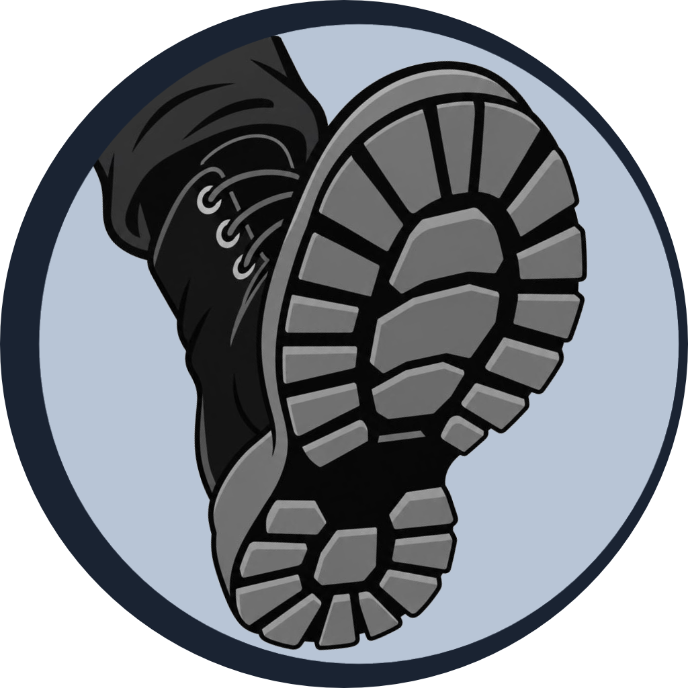</a> 
      <strong>K1X</strong> 
      Kick drum (909 / 808 / 707 / Tight / Hard). One job. It thumps. 
      <a href="https://iamtew.github.io/K1X/">Site</a> ·
      <a href="https://github.com/iamtew/K1X">Repo</a>
    </td>
    <td align="center" width="16%">
      <a href="https://iamtew.github.io/SNR3/">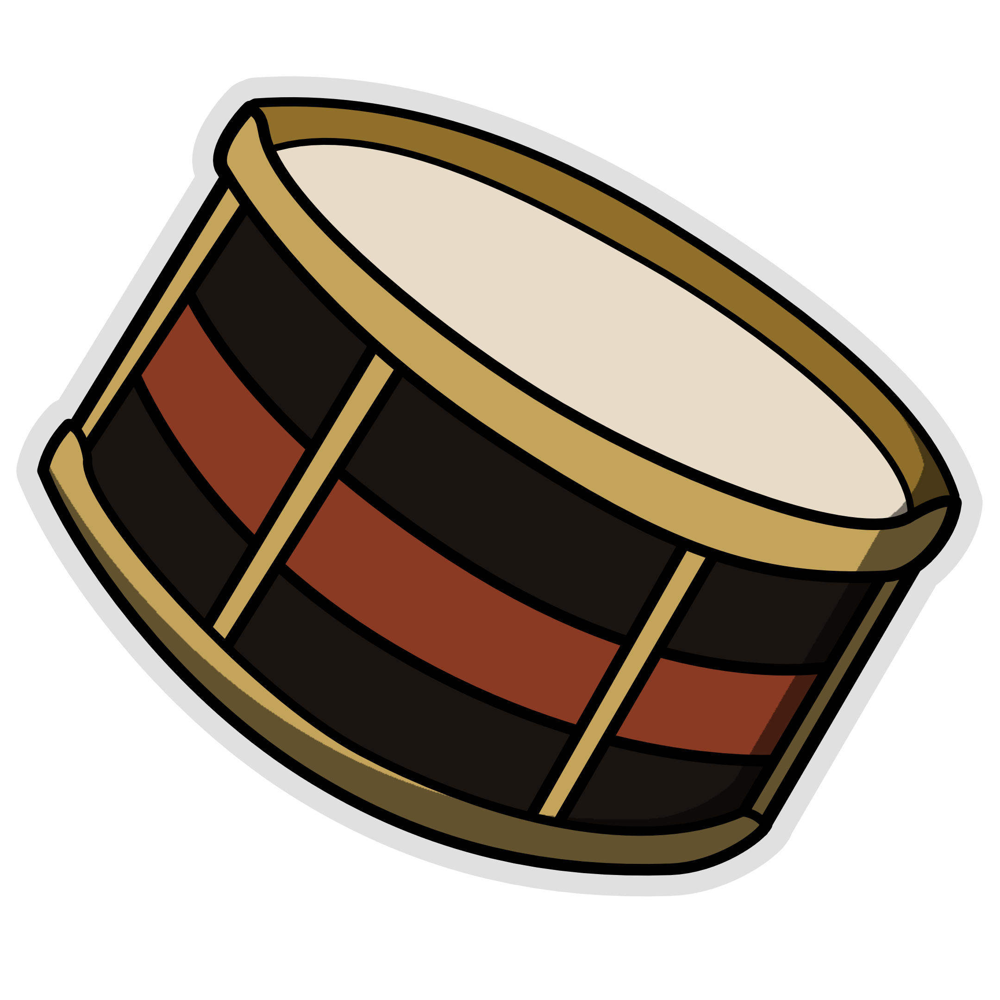</a> 
      <strong>SNR3</strong> 
      Snare one-shot. 909-ish default. 
      <a href="https://iamtew.github.io/SNR3/">Site</a> ·
      <a href="https://github.com/iamtew/SNR3">Repo</a>
    </td>
    <td align="center" width="16%">
      <a href="https://iamtew.github.io/5HKR/">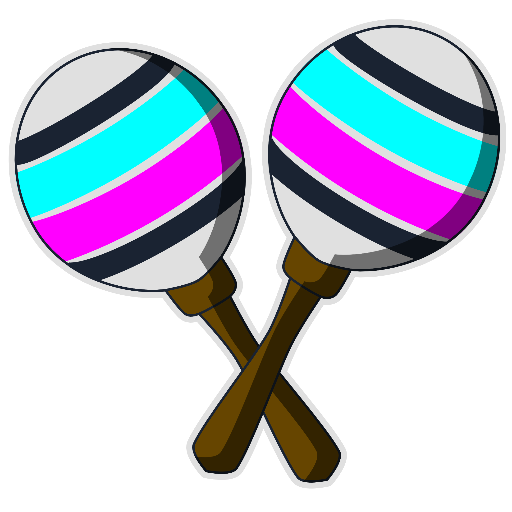</a> 
      <strong>5HKR</strong> 
      Shaker. Percussion overlay. 
      <a href="https://iamtew.github.io/5HKR/">Site</a> ·
      <a href="https://github.com/iamtew/5HKR">Repo</a>
    </td>
    <td align="center" width="16%">
      <a href="https://iamtew.github.io/V4JB/">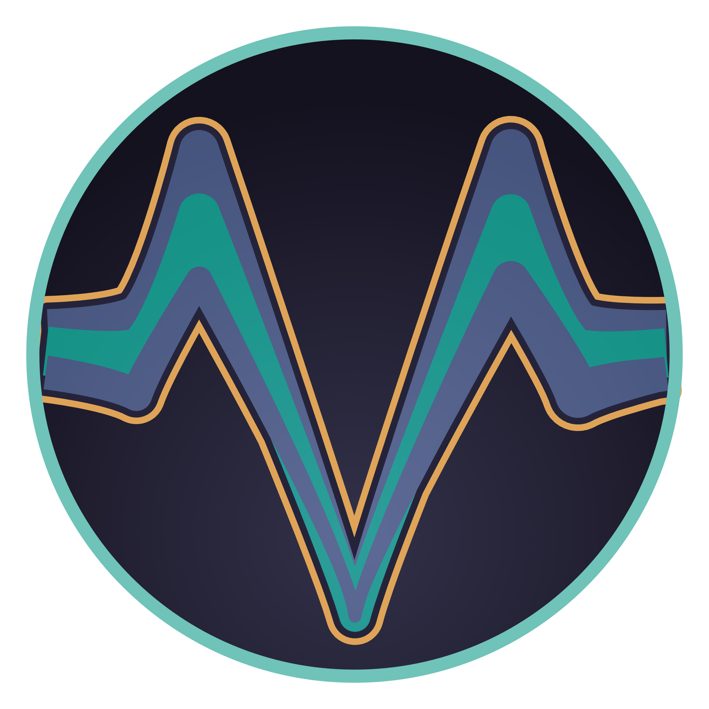</a> 
      <strong>V4JB</strong> 
      Atmosphere and texture. Pads, drones, air, fog. 
      <a href="https://iamtew.github.io/V4JB/">Site</a> ·
      <a href="https://github.com/iamtew/V4JB">Repo</a>
    </td>
    <td align="center" width="16%">
      <a href="https://iamtew.github.io/F4RT/">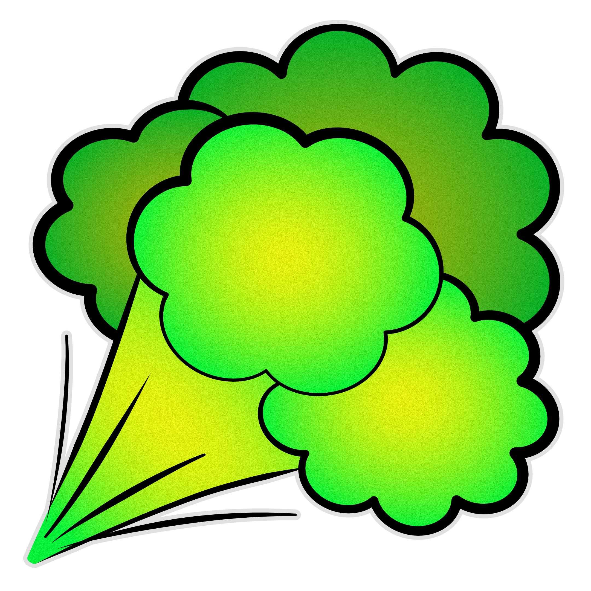</a> 
      <strong>F4RT</strong> 
      PsyFart Designer. 
      <a href="https://iamtew.github.io/F4RT/">Site</a> ·
      <a href="https://github.com/iamtew/F4RT">Repo</a>
    </td>
  </tr>
  <tr>
    <td align="center" width="16%">
      <a href="https://iamtew.github.io/fR3Z0/">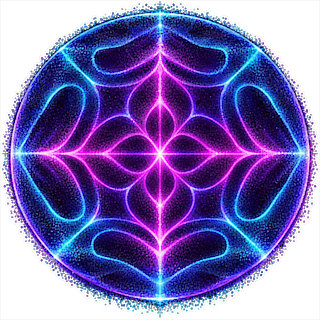</a> 
      <strong>ƒR3Z0</strong> 
      Resonator effect. 
      <a href="https://iamtew.github.io/fR3Z0/">Site</a> ·
      <a href="https://github.com/iamtew/fR3Z0">Repo</a>
    </td>
    <td align="center" width="16%">
      <a href="https://iamtew.github.io/fN0B/">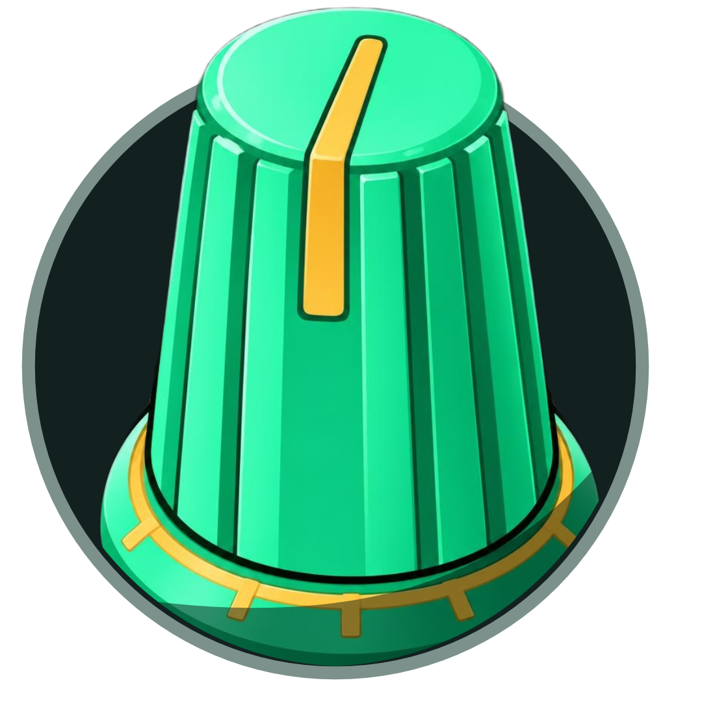</a> 
      <strong>ƒN0B</strong> 
      One-knob effect. 
      <a href="https://iamtew.github.io/fN0B/">Site</a> ·
      <a href="https://github.com/iamtew/fN0B">Repo</a>
    </td>
  </tr>
</table>

## TEW03

A monophonic acid synth. Classic 303 squelch (saw/square, resonant filter, accent, slide, drive) plus extra nastiness.

[Site](https://iamtew.github.io/TEW03/) · [Repo](https://github.com/iamtew/TEW03) · [Download](https://github.com/iamtew/TEW03/releases/latest)

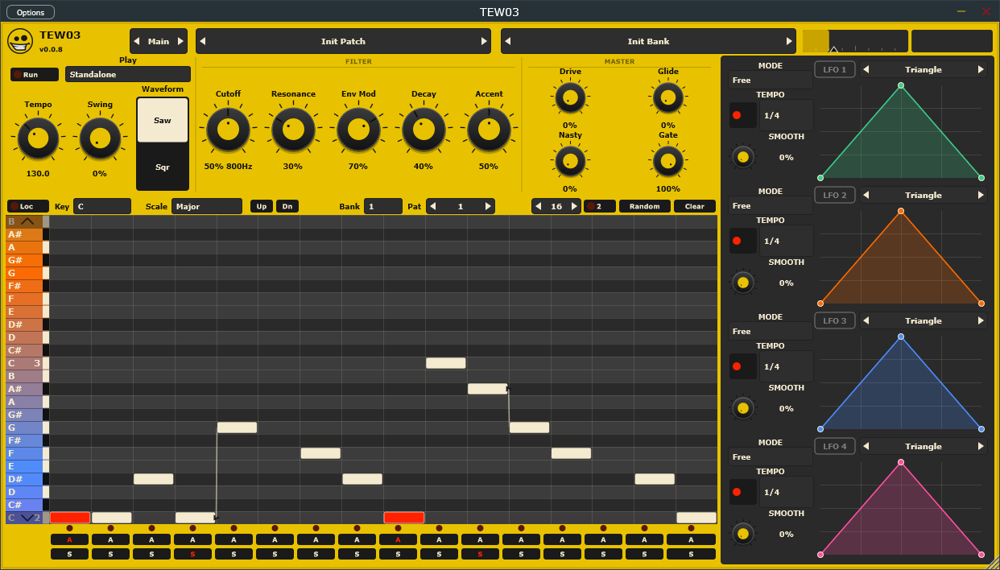

## K1X

A kick drum (909 default, plus 808 / 707 / Tight / Hard). One job. It thumps.

[Site](https://iamtew.github.io/K1X/) · [Repo](https://github.com/iamtew/K1X) · [Download](https://github.com/iamtew/K1X/releases/latest)

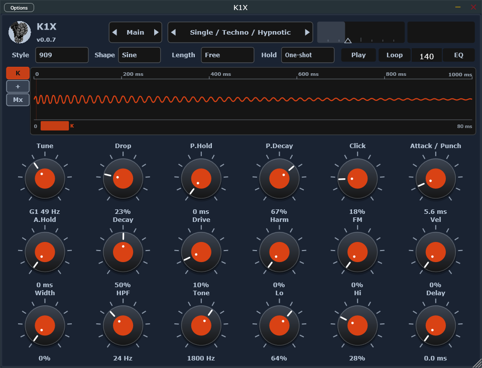

## SNR3

A snare one-shot. 909-ish default: short stick, mid wires, short shell.

[Site](https://iamtew.github.io/SNR3/) · [Repo](https://github.com/iamtew/SNR3) · [Download](https://github.com/iamtew/SNR3/releases/latest)

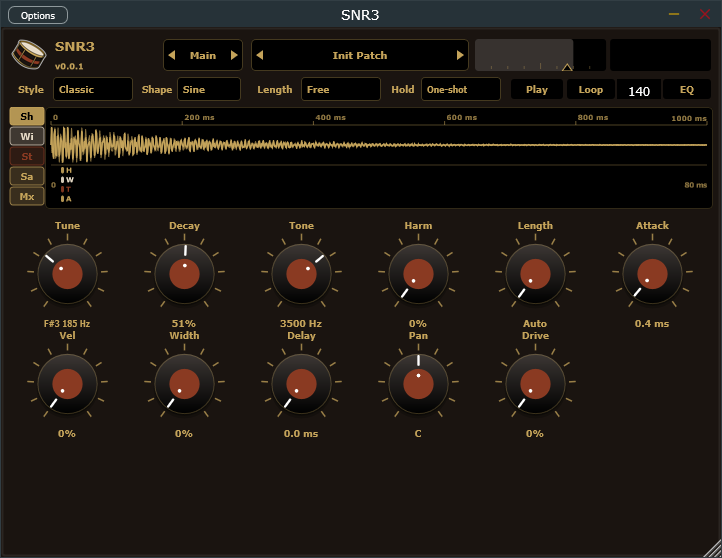

## 5HKR

Shaker. Percussion overlay.

[Site](https://iamtew.github.io/5HKR/) · [Repo](https://github.com/iamtew/5HKR) · [Download](https://github.com/iamtew/5HKR/releases/latest)

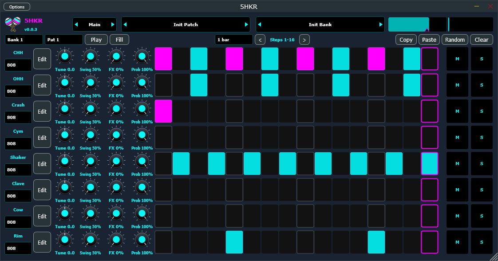

## V4JB

An atmosphere and texture instrument. Pads, drones, air, fog. Sister plugin to TEW03 and K1X, for when you want vibe instead of acid.

[Site](https://iamtew.github.io/V4JB/) · [Repo](https://github.com/iamtew/V4JB) · [Download](https://github.com/iamtew/V4JB/releases/latest)

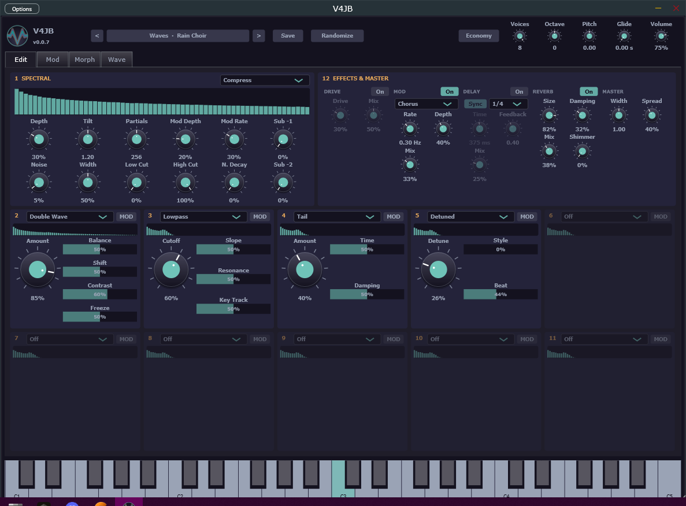

## F4RT

PsyFart Designer. MIDI-triggered psytrance farts, squelches, croaks, zaps, and formant hits.

[Site](https://iamtew.github.io/F4RT/) · [Repo](https://github.com/iamtew/F4RT) · [Download](https://github.com/iamtew/F4RT/releases/latest)

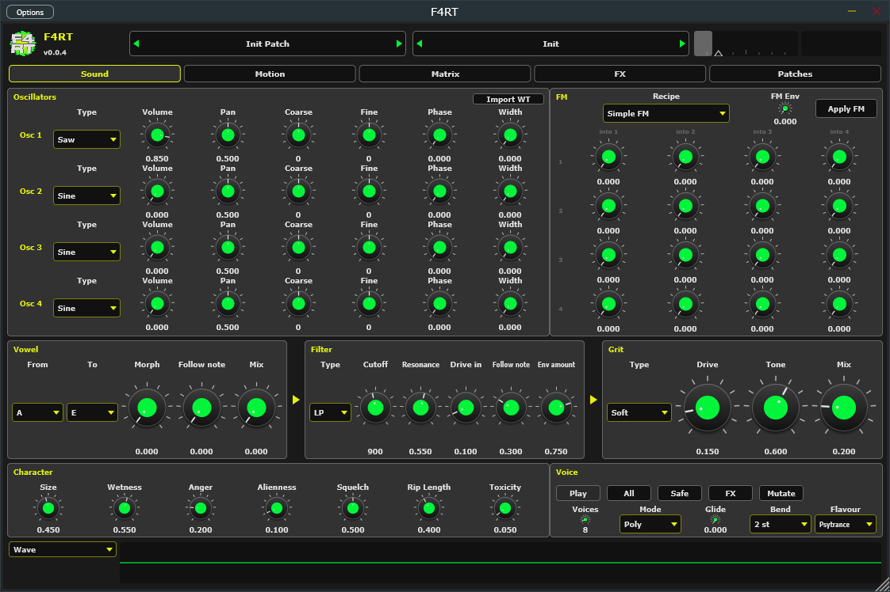

## ƒR3Z0

A resonator effect. Eight bandpass voices, a graph that writes the same parameters as the knobs, two LFOs.

[Site](https://iamtew.github.io/fR3Z0/) · [Repo](https://github.com/iamtew/fR3Z0) · [Download](https://github.com/iamtew/fR3Z0/releases/latest)

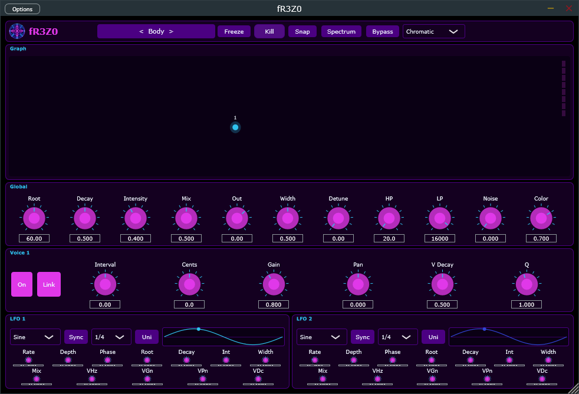

## ƒN0B

A one-knob effect. Pick a preset, turn the knob, hear the chain move.

[Site](https://iamtew.github.io/fN0B/) · [Repo](https://github.com/iamtew/fN0B) · [Download](https://github.com/iamtew/fN0B/releases/latest)

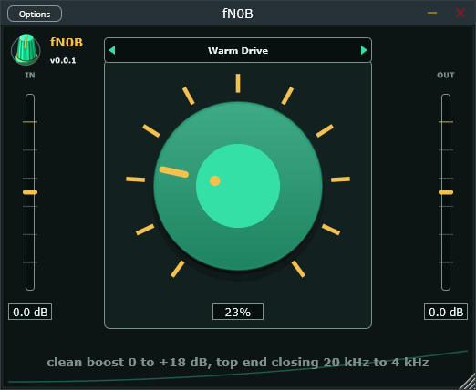

## This repo

Catalog site for the Stupid Audio product line. Static HTML on GitHub Pages: [iamtew.github.io/audio-plugins](https://iamtew.github.io/audio-plugins/).

Each plugin keeps its own site, downloads, and GitHub repo. This hub only lists them.

The site lives in `docs/`. The animated backdrop (`docs/js/fx.js`) uses a vendored [PixiJS](https://pixijs.com/) build (`docs/js/vendor/pixi.min.mjs`, MIT license beside it). No build step. If WebGL is unavailable, or the visitor prefers reduced motion, the page falls back to its CSS gradients (or a still frame).

Preview locally with `python -m http.server` from `docs/`.

After a plugin logo changes in its checkout, run `just logos` here to copy the PNGs into `docs/img/`. After a plugin screenshot changes, run `just screenshots` (reads `~/src/<plugin>/docs`). After a plugin-site demo clip changes, run `just demos`. After `assets/icon.png` changes, run `just icon` to rebuild `docs/img/icon-32.png`, `docs/img/icon-144.png`, `docs/img/icon-512.png`, and `docs/img/favicon.ico`.
